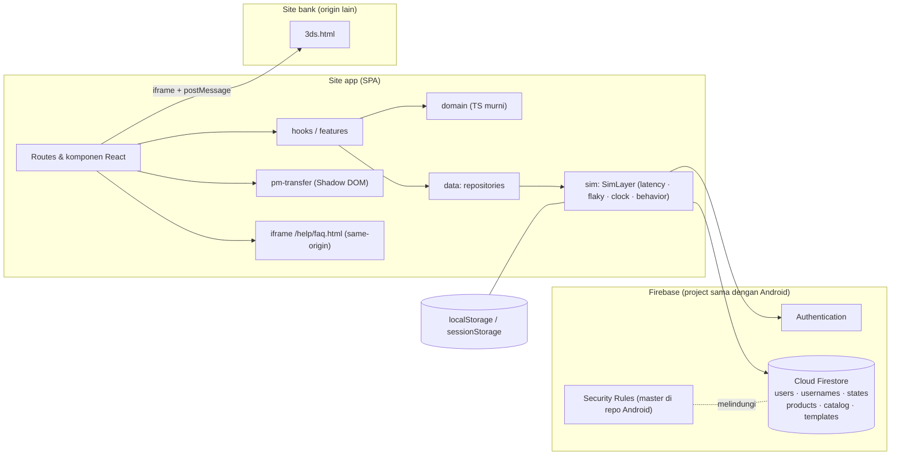
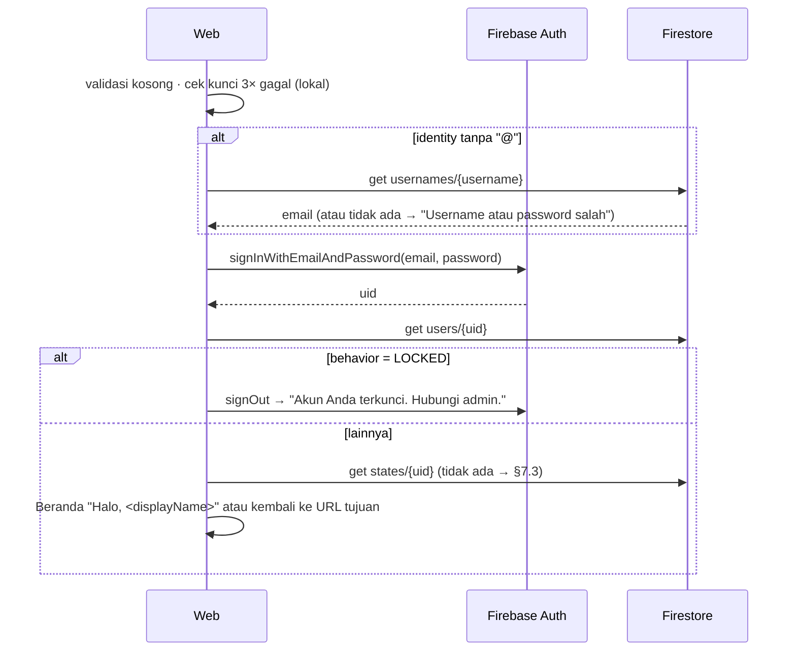

# Architecture — PracticeMart Web

| Field | Isi |
|---|---|
| Dokumen | Architecture & Tech Stack (web) |
| Aplikasi | **PracticeMart Web**: SPA marketplace + fitur dompet PracticePay, target latihan automation web |
| Terkait | `PRD.md` (Web v0.1) · `docs/contract.md` v1.0 (kontrak bersama, **berlaku bila ada konflik**) · PRD Android v0.7 (`PracticeMarket.apps/PRD.md`) |
| Versi | 1.0 (Draft) |
| Tanggal | 19 November 2026 |
| Owner | Dhandy |

**Perubahan dari v0.3** (v0.3 masih memakai model PRD v0.5 gabungan Android + web):
1. **Database:** data lokal/in-memory diganti **Cloud Firestore** dengan skema `docs/contract.md` §8.2, satu project dengan app Android.
2. **Autentikasi:** **Firebase Authentication** (email + password). Login bisa memakai username lewat `usernames/{username}` (kontrak §8.1).
3. **Fitur seed data default dihapus dari klien.** Tidak ada katalog/seed yang dibundel, tidak ada "Reset data akun", tidak ada preset, tidak ada `seedVersion`. Akun uji, katalog, stok, dan template dibuat dan diisi ulang **hanya** oleh script admin di repo Android (`tools/firebase/seed.mjs`). Isolasi test memakai akun baru hasil Register (PRD §6.3 prinsip 6).
4. **Fitur realtime dihapus.** Tidak ada `onSnapshot`, teks "Tersinkron…", atau `updatedBy`. Data dibaca terbaru saat halaman dibuka atau dimuat ulang (kontrak §7, PRD §3.2).
5. Dokumen ini khusus web. Android punya ARCHITECTURE sendiri di `PracticeMarket.apps`.

---

## 1. Prinsip
1. **Kontrak dulu.** Business rules, test data, skema Firestore, dan aturan tulis ada di `docs/contract.md`. Dokumen ini merujuk nomor bagiannya dan tidak menyalin nilainya, supaya tidak terjadi drift.
2. **Satu backend dengan Android.** Firebase project yang sama (plan Spark): Authentication + Cloud Firestore + Hosting. Tanpa server sendiri dan tanpa Cloud Functions. Semua aturan bisnis berjalan di browser dan dibatasi Security Rules.
3. **Baca saat dibuka, bukan realtime.** Setiap halaman membaca data terbaru saat route dibuka, saat tombol "Muat ulang" ditekan, saat tab kembali aktif (`visibilitychange`), atau saat halaman di-reload.
4. **Klien tidak membuat data default.** Klien hanya membaca katalog & template yang sudah ada di Firestore. Klien tidak bisa me-reset data.
5. **Deterministik & bisa dikontrol.** Waktu, keacakan, delay, dan error buatan dikumpulkan di satu SimLayer, diatur lewat Developer Options atau URL (PRD §10).
6. **Testability adalah public API.** `data-testid`, `aria-label`, URL, dan teks assertion mengikuti PRD §12 dan sama dengan Android.
7. **Desktop saja** (≥ 1280 px, PRD NFR-03).

## 2. Ringkasan keputusan
| # | Keputusan | Pilihan | Alasan |
|---|---|---|---|
| D1 | Auth | Firebase Authentication email + password. Identity tanpa `@` → baca `usernames/{username}` → email → `signInWithEmailAndPassword` | Kontrak §8.1; akun uji pakai username (`standard_user`, dst.) |
| D2 | Database | Cloud Firestore `(default)`, skema kontrak §8.2 | Sama dengan Android |
| D3 | Katalog & stok | Dibaca dari `products/{id}` + `catalog/meta` (FR-SHOP-03). Stok global di `products/{id}.stock` | Kontrak §4.2, §8.2 |
| D4 | Data akun | `states/{uid}` (satu dokumen) + subkoleksi `orders/`, `transactions/` | Kontrak §8.2 |
| D5 | Data awal akun | Saat login pertama, bila `states/{uid}` belum ada, klien **menyalin** `templates/account` (atau `templates/newUser` untuk behavior `NEW`) dalam satu transaksi. Tidak ada data default di kode klien dan tidak ada reset | Kontrak §8.2 ("dibuat dari template saat akun pertama kali login"), §4.5 |
| D6 | Tanpa realtime | `getDoc`/`getDocs`/`runTransaction` saja. Satu-satunya listener adalah `onAuthStateChanged` untuk bootstrap sesi | Kontrak §7; hemat kuota |
| D7 | Aturan tulis | Persis kontrak §8.3 (transaksi untuk pesanan, saldo, status; `updateDoc` per field untuk sisanya) | Dua client tidak saling menimpa |
| D8 | Rules, index, seed | **Milik repo Android.** Web menyimpan salinan `firestore.rules` hanya untuk test Emulator; CI memastikan salinan sama dengan master | Kontrak §8.4; satu sumber |
| D9 | Pengaturan perangkat | `localStorage` (Developer Options kontrak §5, "Ingat saya", onboarding, bahasa, tema) | Kontrak §7: per browser |
| D10 | State checkout | `sessionStorage` | FR-PAYM-04 (tahan reload & pindah tab) |
| D11 | Framework | React 19 + TypeScript strict + Vite 8 + React Router 8 | §3 |
| D12 | Hosting | Firebase Hosting, **2 site**: `app` (SPA) dan `bank` (halaman 3DS, origin berbeda) | FR-PAYM-07: iframe lintas origin sungguhan |
| D13 | Shadow DOM | Alur Transfer (PAY-03/04) sebagai custom element `<pm-transfer>` dengan shadow root terbuka | PRD §8.5 |
| D14 | Status pesanan | Disimpan di dokumen (`status`, `statusAt`, `stamps`) dan dimajukan oleh simulator di client yang terbuka, memakai transaksi compare-and-set | Kontrak §7, §8.3 |
| D15 | Aturan bisnis | Modul TypeScript murni di `src/domain/`, diuji dengan kasus yang sama dengan unit test Kotlin Android | PRD §15, NFR-16 |
| D16 | App Check | Tidak di-enforce di v1 | Enforcement memblokir browser automation tanpa debug token |

## 3. Tech stack
Versi major di bawah sudah dicek per November 2026. Versi patch dikunci di `package.json` saat W1.

| Area | Teknologi | Catatan |
|---|---|---|
| Bahasa | TypeScript (strict) | NFR-12 |
| UI | React 19 | – |
| Build | Vite 8 | Bundler Rolldown; code splitting per route untuk NFR-07 (≤ 400 KB gzip awal) |
| Routing | React Router 8 (`react-router`, `createBrowserRouter`, lazy route) | Di v8 paket `react-router-dom` sudah tidak ada; import dari `react-router` dan `react-router/dom` |
| Firebase | Firebase JS SDK 13.x modular: `firebase/app`, `firebase/auth`, `firebase/firestore` | `initializeFirestore(app, { localCache: persistentLocalCache({ tabManager: persistentMultipleTabManager() }) })` |
| State | Custom hooks + React context untuk sesi & `states/{uid}` yang sedang dimuat | Tanpa library state global |
| Styling | CSS Modules + CSS custom properties `--pm-*` (token `design.md`) | Font di-self-host, tanpa Google Fonts CDN |
| i18n | `src/i18n/{id,en}.json` | Teks sama dengan `strings.xml` Android (NFR-11) |
| QR | Library decode QR dari frame kamera/gambar (dipilih di W4, mis. `jsQR`) | FR-PAY-09 |
| Kualitas | ESLint, Prettier, Vitest, `@firebase/rules-unit-testing`, `@axe-core/playwright` | – |
| Test bawaan | Playwright (TS), Cypress, WebdriverIO | PRD §14 |
| CI/CD | GitHub Actions + Firebase CLI | §12 |

**Sengaja tidak dipakai:** Cloud Functions, Cloud Storage, FCM, Analytics/Crashlytics, Realtime Database, listener realtime Firestore, App Check enforcement, Google Fonts CDN, library state global.

## 4. Gambaran arsitektur


**Aturan dependensi:** UI → hooks → domain & repository → SimLayer → Firebase SDK. Hanya SimLayer yang membaca pengaturan Developer Options, sehingga semua kesulitan buatan ada di satu tempat. Domain tidak meng-import Firebase.

## 5. Struktur repository
```
PracticeMart.web/
├── src/
│   ├── app/            # router, layout header, auth guard, provider sesi
│   ├── routes/         # satu modul per halaman PRD §6.2 (lazy)
│   ├── components/     # komponen design system (Modal, Toast, PinPad, ProductCard, …)
│   ├── features/       # auth, shop, cart, checkout, orders, pay, account, help, dev
│   ├── domain/         # PriceCalculator, VoucherRules, Luhn, OrderId, PinHash, … (kontrak §2, §8.6)
│   ├── data/           # repositories Auth & Firestore + tipe skema (kontrak §8.2)
│   ├── sim/            # SimLayer, AppClock, settings, glitch (kontrak §3, §5)
│   ├── i18n/           # id.json, en.json
│   └── styles/         # tokens.css
├── public/help/        # faq.html, contact.html (iframe same-origin & bersarang)
├── bank/               # site kedua: 3ds.html (HTML + JS statis, tanpa Firebase)
├── firebase/           # firebase.json, .firebaserc, firestore.rules (salinan master)
├── scripts/            # check-locators.ts, check-contract.ts, check-bundle-size.ts
├── tests/{playwright,cypress,wdio}/
└── docs/               # contract.md, locators/, curriculum.md, … (PRD §14)
```

## 6. Model data
### 6.1 Data yang ada di mana
| Data | Lokasi | Ditulis oleh | Catatan |
|---|---|---|---|
| Akun & sesi login | Firebase Authentication (sesi di IndexedDB, `browserLocalPersistence`) | user (Register) / admin | FR-AUTH-17 |
| Profil akun & behavior | `users/{uid}` | user (create), admin (behavior) | Kontrak §8.4 |
| Username → email | `usernames/{username}` | admin | Hanya akun uji |
| Keranjang, wishlist, riwayat pencarian, alamat, profil, saldo, PIN, voucher, `orderSeq` | `states/{uid}` | user | Satu dokumen per akun |
| Pesanan | `states/{uid}/orders/{orderId}` | user | – |
| Transaksi PracticePay | `states/{uid}/transactions/{txId}` | user (append) | – |
| Katalog & stok global | `products/{id}`, `catalog/meta` | admin; user hanya field `stock` | – |
| Template akun baru | `templates/account`, `templates/newUser` | admin | Dibaca klien sekali (D5) |
| Developer Options, bahasa, tema, "Ingat saya", onboarding | `localStorage` | browser | Kontrak §5, §7 |
| Draft checkout | `sessionStorage` | browser | FR-PAYM-04 |
| Hitungan gagal login | memori + `localStorage` per client | browser | Kontrak §2: tidak disimpan di cloud |

### 6.2 Skema
Skema lengkap: **kontrak §8.2**. Di web, tipe TypeScript di `src/data/schema.ts` meniru tabel itu satu-satu. Aturan baca:
- Uang integer Rupiah, waktu epoch ms dari `AppClock` (bukan `serverTimestamp`, supaya mode deterministik tetap berlaku).
- Status pesanan disimpan sebagai `WAITING`/`PAID`/`PACKED`/`SHIPPED`/`DONE`/`CANCELLED`, lalu dipetakan ke teks UI.
- Setiap dokumen dibaca lewat fungsi `parse*()` yang memberi default untuk field yang belum ada dan menerima `schemaVersion` lama (kontrak §8.5). Klien tidak pernah menghapus field.

### 6.3 Index
Query web: `orders` urut `createdAt` turun, `transactions` urut `at` turun + rentang tanggal. Keduanya cukup memakai index field tunggal otomatis. Index komposit, bila nanti diperlukan, ditambahkan di `firestore.indexes.json` repo Android.

## 7. Alur utama
### 7.1 Login


| Kondisi | Sumber | Teks UI |
|---|---|---|
| Field kosong | validasi klien | `"Username wajib diisi"`, `"Password wajib diisi"` (FR-AUTH-05) |
| Username tidak ada / password salah | `usernames` tidak ada, `auth/invalid-credential`, `auth/user-not-found`, `auth/wrong-password` | `"Username atau password salah"` (FR-AUTH-06) |
| 3× gagal berturut-turut | hitungan lokal, dicek **sebelum** memanggil Firebase | `"Coba lagi dalam 30 detik"` (FR-AUTH-07) |
| `behavior = LOCKED` | `users/{uid}` | `"Akun Anda terkunci. Hubungi admin."` (FR-AUTH-08) |
| `auth/too-many-requests` | Firebase | `"Terlalu banyak percobaan. Coba lagi nanti."` (kontrak §6) |

URL tujuan sebelum login disimpan di `sessionStorage` (`pm.redirectAfterLogin`), tidak di query string, supaya tidak menambah parameter URL publik.

### 7.2 Register
1. `createUserWithEmailAndPassword(email, password)`.
2. Tulis `users/{uid}`: `username = email`, `email`, `displayName = nama`, `behavior = NORMAL`, `schemaVersion` (kontrak §8.1).
3. Inisialisasi `states/{uid}` dari template (§7.3).
4. `signOut`, lalu buka halaman Login (FR-AUTH-12: sukses → Login).

Akun hasil Register login memakai email (tidak ada dokumen `usernames/` untuknya).

### 7.3 Inisialisasi akun dari template
Satu `runTransaction`:
1. Baca `states/{uid}`. Bila sudah ada → selesai (idempoten; aman bila login pertama terjadi bersamaan di web dan Android).
2. Baca `templates/newUser` bila `behavior = NEW`, selain itu `templates/account`.
3. Tulis `states/{uid}` = isi template tanpa `transactions`, ditambah `orderSeq: 0` dan `schemaVersion`.
4. Tulis setiap item `transactions` template ke `states/{uid}/transactions/{id}`.

Ini bukan fitur seed: klien tidak punya data default sendiri, tidak ada UI untuk memicunya, dan tidak bisa mengulanginya untuk akun yang sudah ada.

### 7.4 Lupa password
Dihapus dari web (PRD FR-AUTH-13, 2026-11-20). Login tidak punya link Lupa password dan rute `/forgot-password` tidak ada.

### 7.5 Sesi
`browserLocalPersistence` (default): sesi bertahan setelah reload, tutup tab, dan restart browser sampai Keluar (FR-AUTH-17). *Clear site data* menghapus sesi, tetapi data di Firestore tetap ada (EDGE-01). App shell menunggu `onAuthStateChanged` pertama sebelum me-render route terproteksi.

### 7.6 Keranjang, wishlist, riwayat, alamat, profil
- Baca: `getDoc(states/{uid})` saat route dibuka dan saat app shell dimuat (untuk badge keranjang & sapaan).
- Tulis: `updateDoc(states/{uid}, { cart })`, `{ wishlist }`, dst., satu field per aksi (kontrak §8.3).
- Karena tidak ada realtime, perubahan dari Android baru terlihat setelah halaman dibuka/dimuat ulang. Tabrakan di field yang sama = last-write-wins, dan kontrak menerimanya.

### 7.7 Checkout & pembayaran
Satu `runTransaction` saat pembayaran disetujui:
1. Baca `states/{uid}` (`orderSeq`, `balance`) dan `products/{id}` setiap baris.
2. Validasi stok varian (`"<warna>|<ukuran>"`) dan saldo (PracticePay). Hitung total dengan `src/domain` (kontrak §2).
3. Tulis `orders/{PM-YYYYMMDD-XXXX}` dengan `XXXX = orderSeq + 1` (kontrak §8.3), naikkan `orderSeq`, kurangi stok.
4. PracticePay: kurangi `balance` & `homeBalance` (kecuali bug glitch §3.6) dan tambah dokumen `transactions/`.
5. Hapus baris keranjang yang dibayar dan lepaskan voucher. Beli Sekarang (`keepCart`) tidak menyentuh keranjang; baris dibawa lewat history state `/checkout`.

| Metode | Hasil |
|---|---|
| Kartu sukses `4111…` | overlay `"Memproses pembayaran…"` → modal 3DS (§10.1) → OTP benar → transaksi → status `PAID` |
| Kartu ditolak `…0002` | tidak ada order yang ditulis; keranjang utuh; `"Pembayaran Gagal"` (N-05) |
| Kartu pending `…0119` | order `WAITING` (N-06) |
| VA | pilih bank BCA/BNI/Mandiri (disimpan di `methodLabel`, tanpa field baru) → order `WAITING` dengan `vaDeadline` (Batas waktu VA dari §9). Halaman hasil & Detail Pesanan menampilkan `VaPanel`: nomor VA (`vaNumber()` di `src/domain/payment.ts`, dihitung dari Order ID), Salin, countdown, cara bayar, Cek Status |
| PracticePay | PIN (§7.9) → transaksi → `PAID` |
| COD | order dibuat lalu ikut alur status seperti `PAID` (asumsi, lihat K6) |

- **Double submit (EDGE-03):** tombol Bayar disabled setelah klik pertama dan satu promise in-flight per tab. Dua pesanan dari dua perangkat tetap sah dan mendapat nomor urut berbeda karena `orderSeq` ditulis di transaksi (EDGE-12).
- **Offline (FR-PAYM-15):** `navigator.onLine` + event `online`/`offline` → banner `"Tidak ada koneksi"` dan Bayar disabled. Transaksi Firestore memang membutuhkan server, sehingga tidak ada pesanan yang tertunda di antrean.

### 7.8 Status pesanan
- Simulator berjalan saat halaman Pesanan Saya atau Detail Pesanan terbuka. Setiap tick: bila `now ≥ statusAt + interval`, jalankan transaksi yang mengubah status **hanya bila** status di dokumen masih sama dengan yang diharapkan (kontrak §8.3), mengisi `stamps[next]` dan `statusAt`.
- Saat halaman dibuka setelah lama ditutup, simulator mengejar ketertinggalan langkah demi langkah sampai status sesuai waktu sekarang.
- Mode Manual: tombol "Status berikutnya" menjalankan transaksi yang sama.
- Saat `DONE`: cashback PracticePay sesuai kontrak §2 masuk lewat transaksi yang sama (`balance` + dokumen `transactions/`).
- VA kedaluwarsa: saat order dibuka dan `now > vaDeadline` dengan status `WAITING` → transaksi `CANCELLED` + kembalikan stok (sekali saja).
- Batalkan: hanya bila status ≤ `PACKED` → transaksi `CANCELLED` + `cancelReason` + kembalikan stok (FR-ORD-03, FR-ORD-05).

### 7.9 PracticePay
- **PIN:** verifikasi `pinHash` dengan PBKDF2 `crypto.subtle` sesuai kontrak §8.6 (iterasi dibaca dari string tersimpan). `pinFailures` dan `pinLockedUntil` ditulis lewat `updateDoc`, sehingga kuncinya juga berlaku di Android (FR-PAY-06).
- **Transfer & bayar QR:** transaksi: cek saldo, kurangi `balance` (dan `homeBalance`, kecuali glitch), tambah dokumen `transactions/`.
- **Top Up (versi sederhana, PRD FR-PAY-02):** `topUpBalance()` di `src/data/walletRepository.ts` → transaksi Firestore: `balance + n` + dokumen `transactions/` `"Top Up Saldo"` (kontrak §8.3). Nominal Rp10.000–Rp10.000.000 divalidasi di form dan repository. Bisa gagal lewat "Peluang error server" (§9).
- **Transfer:** catatan (maks 50) digabung ke judul transaksi, tanpa field baru. "Terakhir" diturunkan dari judul transaksi `"Transfer ke <nama>"` (`recentContacts()`). Notifikasi browser lewat `notify()` (`src/sim/settings.ts`).
- **Badge pesanan aktif:** `countActiveOrders()` = `getCountFromServer` (1 baca agregasi), dihitung saat akun dimuat dan setiap `reloadState`; gagal hitung tidak menggagalkan halaman.
- **Riwayat:** `getDocs` urut `at` turun, `limit(20)` + `startAfter` untuk infinite scroll (FR-PAY-11).

## 8. Routing
- Semua route di PRD §6.2 didaftarkan di `createBrowserRouter` dengan lazy loading per halaman.
- Route terproteksi dibungkus guard. Tanpa sesi → simpan URL tujuan (§7.1) → `/login`.
- `/welcome` tampil bila flag onboarding di `localStorage` belum ada (FR-AUTH-01); `new_user` selalu melihatnya.
- `/login?username=<x>` mengisi field username (FR-AUTH-15).
- `/settings?deterministic=…&latency=…&animations=…&flaky=…` menyimpan pengaturan ke `localStorage`, lalu kembali ke halaman sebelumnya tanpa UI (DEV-02).
- Route `*` → SYS-01 (HTTP 200). Firebase Hosting: rewrite `**` → `/index.html`, kecuali `/help/**`.
- Modal (Image Viewer, Voucher, Filter, PIN, Batalkan) bukan route.

## 9. SimLayer
| Kontrol | Sumber | Efek |
|---|---|---|
| Network latency 0×/1×/2×/3× | `localStorage` | delay buatan sebelum panggilan Firebase tertentu & overlay pembayaran (±2 dtk × latency) |
| Peluang error server 0/30/50% | `localStorage` | `serverFails()` di `src/sim/settings.ts` → `"Gagal memuat, coba lagi"` pada Top Up & Cek Status VA. Mode deterministik: permintaan ke-1 gagal, ke-2 berhasil, dst. (kontrak §5; hitungan per muat halaman) |
| Mode deterministik | `localStorage` | `AppClock` = tanggal 2026-01-15 + jam berjalan sungguhan (Asia/Jakarta); random ber-seed tetap; rekomendasi `P001, P002, P010, P020, P060` |
| Animasi | `localStorage` | semua durasi 0 |
| Batas waktu VA, Update status pesanan | `localStorage` | dipakai saat order dibuat / simulator berjalan (kontrak §5) |
| Locator Hint Overlay | `localStorage` | §11 |
| `behavior = SLOW` | `users/{uid}` | delay 4 dtk di setiap loading (kontrak §4.1) |
| `behavior = GLITCH` | `users/{uid}` | 7 bug kontrak §3, semuanya di `src/sim/glitch.ts` dan dipanggil dari domain/UI. Data di Firestore tetap benar, kecuali `homeBalance` (bug 6) |

Repository memanggil `sim.before(op)` sebelum menyentuh Firebase. Komponen lain tidak membaca pengaturan ini langsung.

## 10. Frame, Shadow DOM & API browser
### 10.1 3D Secure (iframe lintas origin)
- Halaman `bank/3ds.html` di site Hosting kedua (mis. `<project>-bank.web.app`; domain final = PRD Q1). Halaman statis tanpa Firebase.
- Isi: input `id="otp"` `data-testid="otp"`, Submit, "Batal" yang memanggil `confirm("Batalkan transaksi?")` di dalam iframe (FR-PAYM-07). OTP `123456` sukses, lainnya `"Kode OTP salah"` (kontrak §4.3).
- Hasil dikirim dengan `parent.postMessage({ type: "3ds-result", status }, parentOrigin)`. `parentOrigin` diambil dari query `?parent=` dan divalidasi dengan allowlist (site live + pola preview channel). Halaman induk menolak pesan bila `event.origin` bukan origin bank.
- Site bank di-deploy live saja; preview channel app memakai bank live (`VITE_BANK_ORIGIN`).

### 10.2 Pusat Bantuan (iframe same-origin)
- `public/help/faq.html` dimuat di iframe: search `data-testid="faq-search"`, accordion, `data-testid="btn-contact"` → `parent.postMessage({ type: "contact" }, location.origin)` → toast `"Menghubungkan ke CS PracticeMart…"` (FR-HELP-01).
- `contact.html` sebagai iframe bersarang di dalam `faq.html` (FR-HELP-03). Tombol "Chat dengan CS" ada di halaman induk.

### 10.3 Transfer di Shadow DOM
- `<pm-transfer>` adalah custom element dengan `attachShadow({ mode: "open" })`. React di-mount dengan `createRoot(shadowRoot)`.
- CSS Modules tidak masuk ke shadow root, jadi style di-import sebagai string (`import css from "./transfer.css?inline"`) dan dipasang lewat `adoptedStyleSheets`.
- `data-testid` berada di dalam shadow root (PRD §12.2 aturan 6). Toast & navigasi dikirim ke halaman induk lewat `CustomEvent` dengan `composed: true`.
- Riwayat (PAY-06) sengaja tanpa `data-testid`.

### 10.4 API browser
| API | Dipakai di | Catatan |
|---|---|---|
| Notification | izin setelah onboarding, pesanan berhasil, status, transfer | Tanpa izin → hanya toast |
| Clipboard | salin VA/Order ID (`writeText`), "Tempel" voucher (`readText`) | `readText` butuh izin |
| Geolocation | "Gunakan lokasi saat ini" | Koordinat uji kontrak §4.3 dipetakan ke provinsi/kota |
| `getUserMedia` | Scan QR | Ditolak → `"Izin kamera ditolak"`; alternatif unggah gambar |
| File input & drag-and-drop | foto profil, QR, foto ulasan | Hanya pratinjau lokal (tanpa Cloud Storage); `photoUri` menyimpan referensi lokal (lihat K6) |
| Web Share | Bagikan produk | Fallback salin tautan → `"Tautan disalin"` |
| `online`/`offline`, `visibilitychange` | banner koneksi, EDGE-02 | – |
| `crypto.subtle` | PIN PBKDF2 | Butuh secure context (Hosting/localhost) |
| WebAuthn | passkey (Could) | Lihat K5 |

## 11. Testability
### 11.1 Aturan ID
Setiap elemen interaktif dan setiap teks yang di-assert (PRD §12.2) wajib punya ID untuk automation. `data-testid` tetap menjadi kontrak utama (nama sama dengan resource-id Android). Elemen yang unik di halaman **juga** diberi atribut `id` dengan nilai yang sama, supaya `By.id` / `#id` (Selenium, WebdriverIO) juga bisa dipakai.

| Elemen | `data-testid` | `id` |
|---|---|---|
| Elemen interaktif & teks assertion yang unik di halaman | wajib (PRD §12) | wajib, **nilai sama** dengan `data-testid`, mis. `<input id="shop_input_username" data-testid="shop_input_username">` + `<label for="shop_input_username">` |
| Item list/kartu berulang (`*_item_*_row`, kartu produk, "+ Keranjang") | wajib, boleh kembar | tidak ada (HTML melarang `id` ganda) |
| Elemen di Shadow DOM (`<pm-transfer>`) | wajib, di dalam shadow root | wajib, unik di dalam shadow root |
| Isi iframe 3DS & Pusat Bantuan | sesuai PRD (`otp`, `faq-search`, `btn-contact`) | sama dengan `data-testid` |
| Riwayat (PAY-06) | sengaja tidak ada | sengaja tidak ada (pembanding, PRD §8.5) |
| Wrapper layout tanpa fungsi | tidak ada | tidak ada |

- Komponen memakai helper `src/components/testid.ts`: `tid("shop_input_username")` → `{ id, "data-testid" }` dengan nilai sama; `tid.list("shop_item_product_row")` → hanya `data-testid`. Keduanya tidak ditulis manual, supaya tidak bisa berbeda.
- `id` tidak dibuat acak atau berubah antar build; kontrak stabilitasnya sama dengan `data-testid` (PRD §12.3).
- `aria-label` untuk tombol ikon; elemen HTML semantik agar `getByRole` bekerja. `aria-label` tidak diisi test id (PRD §12.2).

### 11.2 Pemeriksaan & alat bantu
- `scripts/check-locators.ts` memindai `src/`, `public/help/`, `bank/` dan membandingkannya dengan `docs/locators/*.md`. CI gagal bila: ada `data-testid` atau `id` tak terdokumentasi; ada duplikat `data-testid` tak disengaja; elemen unik punya `data-testid` tanpa `id` bernilai sama; ada `id` ganda dalam satu halaman.
- **Locator Hint Overlay:** komponen yang hanya di-mount bila opsi ON, membaca posisi elemen `[data-testid]` dan menempelkan label.
- **About (DEV-04):** versi dari `package.json`, commit SHA & tanggal build lewat `define` Vite, versi kontrak dari konstanta yang dicek CI terhadap header `docs/contract.md`.

## 12. Build, deploy & CI
| Workflow | Isi |
|---|---|
| `web.yml` | install → lint → typecheck → Vitest (domain + kasus kontrak §2, mis. total Rp158.000, voucher, Luhn, vector PBKDF2 yang sama dengan Android) → `check-locators` → `check-contract` (hash `docs/contract.md` = master Android) → build → cek ukuran bundle → deploy preview channel → Playwright & Cypress smoke → `main`: deploy live (site `app` & `bank`) |
| `rules.yml` | test salinan `firestore.rules` dengan Emulator Suite + `@firebase/rules-unit-testing`; gagal bila salinan beda dengan master |
| `nightly.yml` | smoke ke project cloud memakai akun CI hasil Register; EDGE-11/12 bersama pipeline Android |

- Config Firebase web (`VITE_FIREBASE_*`) bukan rahasia dan boleh di repo. Token deploy & kredensial akun CI ada di GitHub Secrets.
- Rules & index **tidak** di-deploy dari repo ini (D8).

## 13. Kuota Spark
Kuota harian dipakai bersama Android + web + CI (kontrak §9: 50.000 baca, 20.000 tulis, 20.000 hapus).

| Aksi | Perkiraan baca | Strategi |
|---|---|---|
| Login | 2–3 (`usernames`, `users`, `states`) | Login sekali per suite (storage state) |
| Buka katalog | 1 + 60 (`catalog/meta` + `products`) | Dimuat sekali per tab lalu disimpan di memori + `sessionStorage`; Detail Produk membaca ulang 1 dokumen untuk stok segar; checkout membaca stok di transaksi |
| Halaman akun/keranjang | 1 (`states/{uid}`) | Satu dokumen per akun |
| Riwayat | ≤ 20 per halaman | `limit(20)` |

Tulis hanya saat data berubah. Lihat K3 untuk risiko katalog.

## 14. Pengujian aplikasi sendiri
| Lapisan | Alat | Cakupan |
|---|---|---|
| Domain | Vitest | 100% aturan kontrak §2, §3, §8.6 |
| Rules | Emulator + `@firebase/rules-unit-testing` | milik sendiri vs akun lain, `behavior`/`username` tidak bisa diubah, `products` hanya `stock` |
| Repository | integration test terhadap Emulator Suite | inisialisasi template idempoten, checkout transaksional, status compare-and-set, VA kedaluwarsa, batal + stok kembali |
| UI | Playwright | smoke per fitur, regresi locator, axe |
| Lintas platform | nightly bersama Android | EDGE-11, EDGE-12 |

Catatan: Auth Emulator tidak meniru email enumeration protection (K1).

## 15. Risiko & keputusan terbuka
| # | Hal | Dampak | Usulan |
|---|---|---|---|
| K1 | *(Hanya Android: Lupa Password dihapus dari web)* **Email enumeration protection** aktif default untuk project Firebase yang dibuat sejak 15 Sep 2023. `sendPasswordResetEmail` tidak lagi melempar `auth/user-not-found` | Teks kontrak §6 `"Email tidak terdaftar"` tidak bisa muncul | Putuskan di W1: matikan protection di project (latihan, akun dummy; risiko enumerasi email diterima) **atau** ubah kontrak §6 di master Android |
| K2 | **Cypress tidak bisa mengotomasi iframe lintas origin** (dokumentasi resmi); `cy.origin` tidak masuk ke iframe | E2E-01 & DoD "hijau di Cypress" bergantung pada `chromeWebSecurity: false` (Chromium saja) | Revisi mitigasi PRD §18; contoh Cypress hanya di Chromium |
| K3 | Katalog 60 dokumen dibaca dari Firestore | ±800 pemuatan katalog per hari untuk seluruh project sebelum kuota baca habis | Usulkan ke master kontrak: katalog statis + satu dokumen stok, atau naik ke Blaze dengan budget alert |
| K4 | `products/{id}.stock` bisa ditulis semua user login | Learner bisa mengosongkan atau mengubah stok global | Rules: key map tidak berubah & nilai integer ≥ 0; admin menjalankan ulang script seed |
| K5 | Firebase Auth tidak punya passkey/WebAuthn bawaan | FR-AUTH-11 & FR-PAY-08 hanya simulasi klien | Tunda ke setelah v1.0 (PRD Q4) |
| K6 | Belum ada di PRD/kontrak: teks `auth/email-already-in-use` di Register, alur status COD, refund saldo saat batal PracticePay, penyimpanan foto profil tanpa Cloud Storage | Implementer menebak | Tambahkan ke PRD/kontrak sebelum W2 |
| K7 | Rate limit Auth (`too-many-requests`) | Test login flaky | Login sekali per suite; kunci lokal 3× gagal |
| K8 | SDK Firestore web memakai koneksi streaming, bukan REST | Latihan network mocking sulit | Dokumentasikan; latihan network memakai offline & Developer Options (PRD §18) |
| K9 | Tanpa realtime + last-write-wins pada array `cart` | Web yang belum di-reload bisa menimpa perubahan keranjang dari Android | Diterima kontrak §8.3; baca ulang `states/{uid}` sebelum menulis keranjang dan saat tab kembali aktif |

## 16. Dampak ke dokumen lain
Dokumen berikut masih memakai model lama (PRD v0.5) dan perlu disesuaikan dengan PRD web v0.1 + kontrak:

| Dokumen | Yang perlu diubah |
|---|---|
| `design.md` & canvas "PracticeMart (web)" | Login email (`shop_input_email`, `"Email atau password salah"`, `locked@practicemart.test`) → username (`shop_input_username`, `"Username atau password salah"`, `locked_user`) |
| | Hapus "Reset data akun" dan "Profil perilaku akun" (WebSettings); Batas waktu VA & Update status pesanan disimpan di browser, bukan akun |
| | Hapus teks sinkron realtime `shop_txt_sync_status` (WebCart) dan catatan "sinkron realtime" di canvas |
| | Breakpoint tablet/mobile → desktop saja (NFR-03) |
| | Pagination 8/halaman → infinite scroll 20/halaman (FR-SHOP-07) |
| | Header: navigasi `shop_tab_home/category/pay/cart/account` (PRD §6.2) |
| | Shadow DOM pindah ke alur Transfer (bukan widget chat); Riwayat tanpa `data-testid` |
| | ACC-05/06 Ubah password tidak ada di PRD web (PRD Q5) |
| | Halaman PRD §6.2 yang belum ada artboard web (onboarding, kategori, ulasan, wishlist, VA, top up, scan QR, transfer, riwayat, akun, 404) |
| `PRD.md` | §18 mitigasi Cypress (K2); keputusan K1, K3, K6; tautan `ARCHITECTURE.md` → `architecture.md` |
| | §12.2: tambah aturan `id` = `data-testid` untuk elemen unik (§11.1). Beri tahu project Android bahwa web menambah `id`; nama locator Android tidak berubah |
